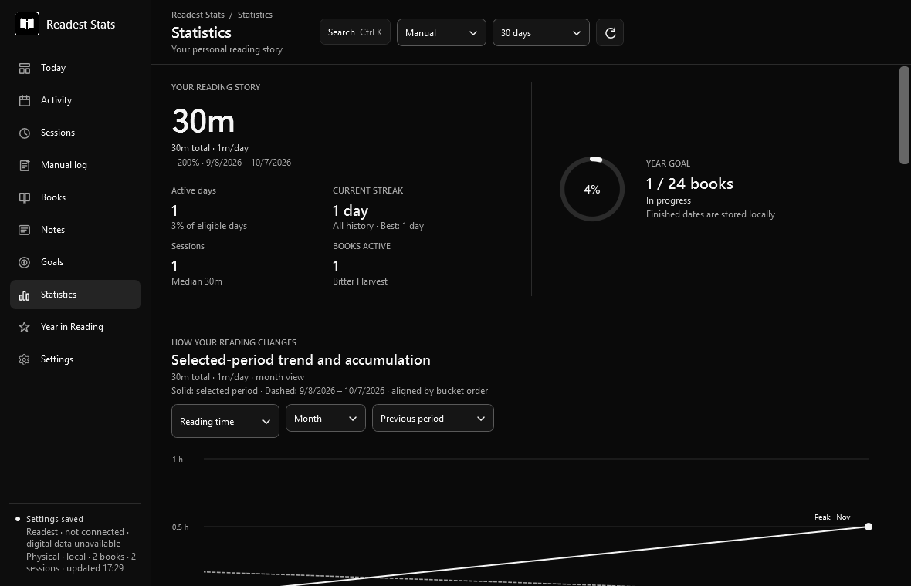
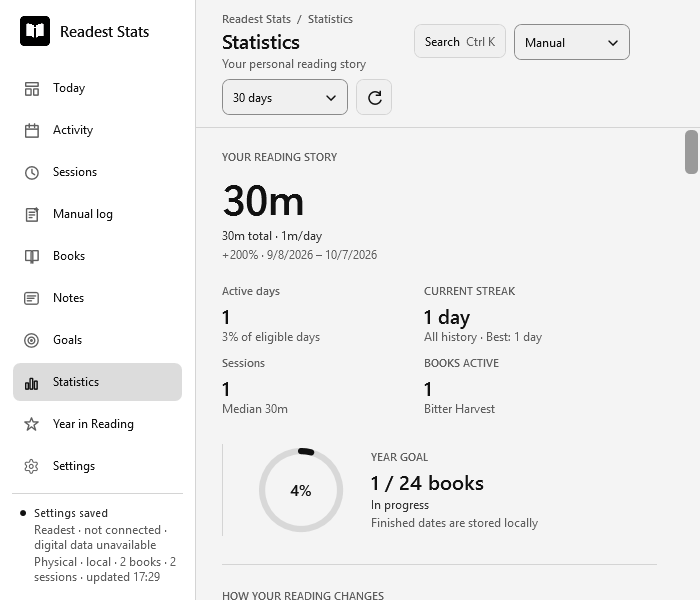
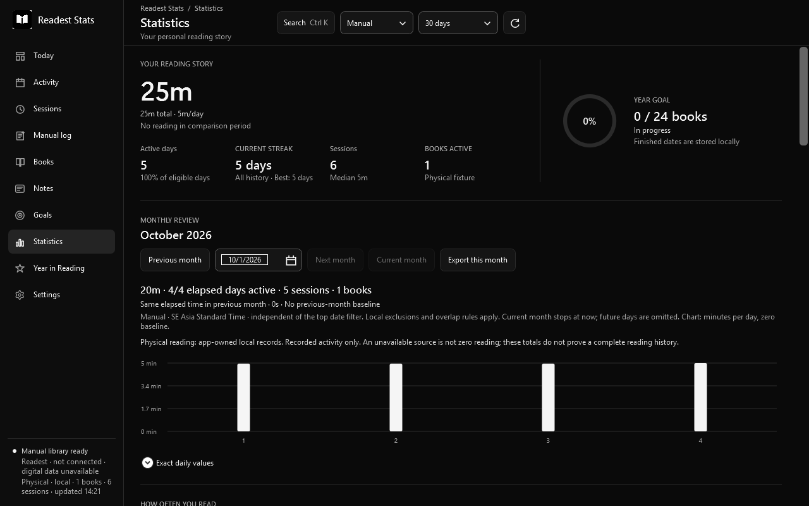
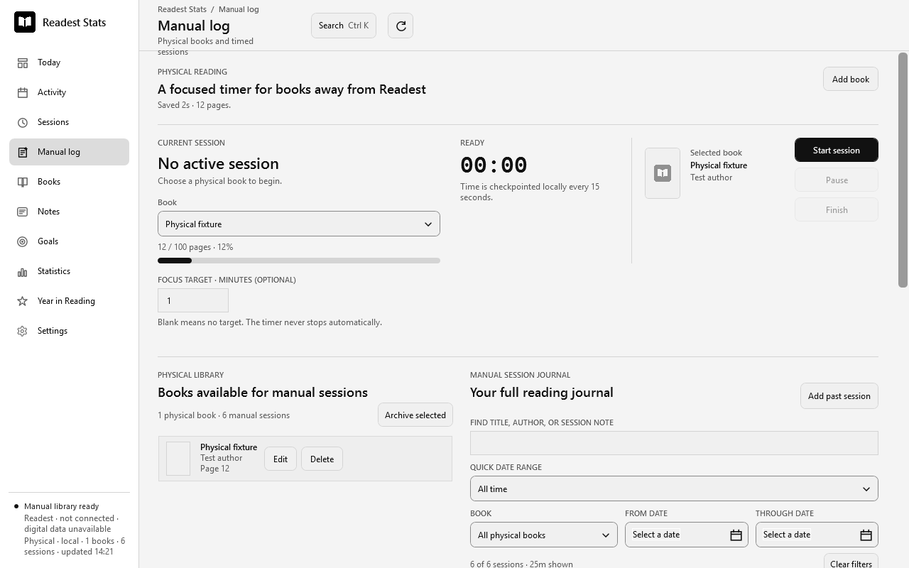
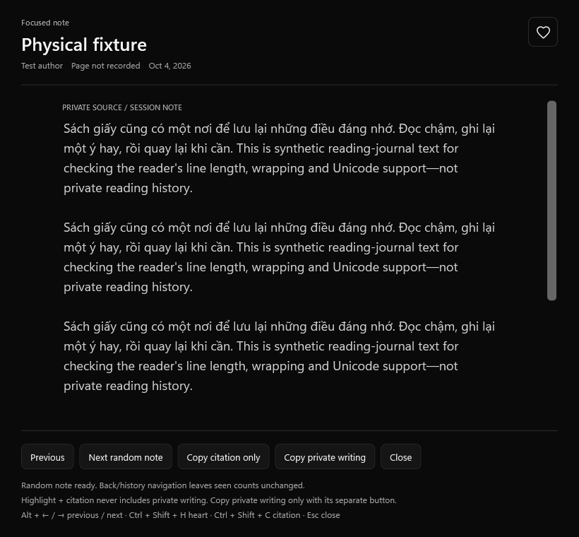
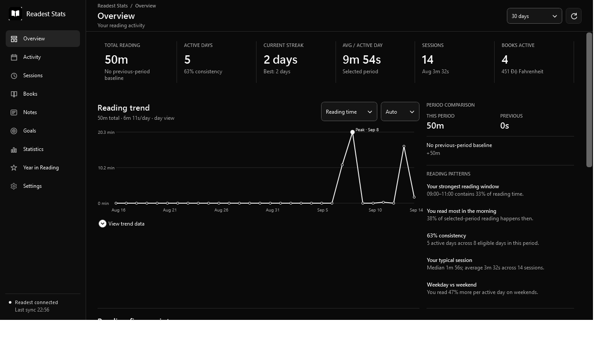
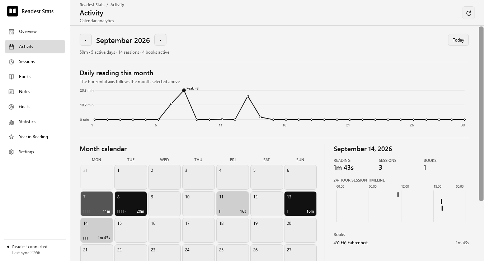
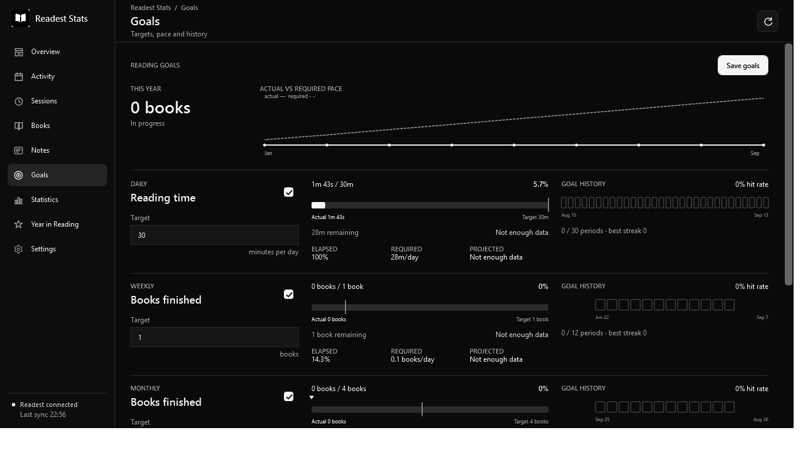
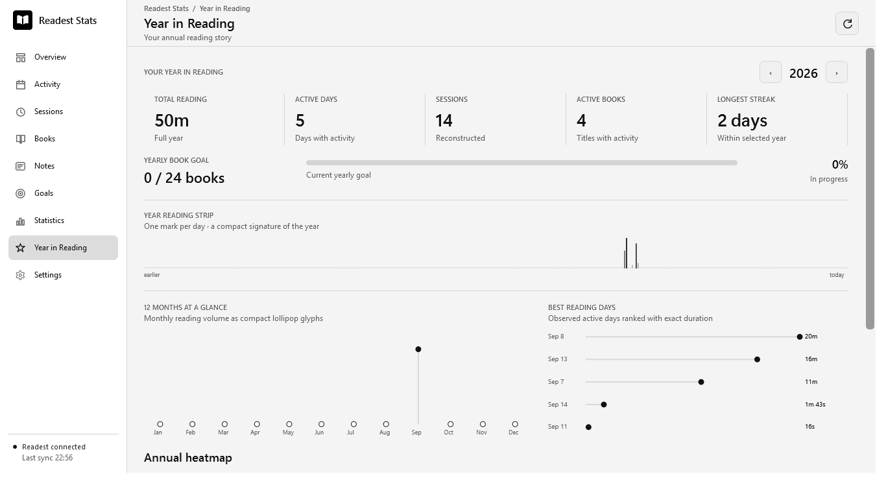

# Readest Stats 2.6.0


[](https://github.com/phunguyen1006/statistics_readest/releases/latest)
[](LICENSE)

Readest Stats is an independent native Windows desktop companion for digital and physical reading. Version 2.6.0 refines its monochrome reading analytics, adapts the main screens to narrower windows, and improves keyboard and assistive-technology access to chart values—all without modifying Readest.

The Statistics reading story combines a keyboard-accessible 365-day heatmap, a 30-day streak strip, a 24-hour reading clock, weekday rhythm, line-based selected-period and 12-month journeys, cumulative reading, direct period comparison, goal progress, session distribution, ranked reading-time bars, and personal records. Every chart is computed from observed event duration and local timestamps; unsupported genre, rating, word-count, and reading-speed dimensions are not guessed.

Other features include one-click opening of a selected local book in Readest, a physical-book library with page progress, source-aware analytics, locally managed reading statuses and finished-book goals, pinned-book filtering, source-quality checks, monthly Markdown reports, update checks, seven rotating complete daily backups, persistent window placement, full-screen mode, and keyboard navigation (Ctrl+M opens Manual log).

Manual books, timer segments, page ranges, session notes, and completed sessions are saved transactionally in `%LOCALAPPDATA%\\ReadestStats\\readest-stats.db`. A human-readable `manual-reading.json` recovery mirror and complete ZIP backups are retained. Existing v1.x JSON data migrates automatically on first launch. If a manual interval overlaps an imported Readest interval, the Readest interval wins in the combined view so reading time is not counted twice.

The Notes tab combines highlights and annotations from Readest's per-book config.json files with notes written after physical-book sessions. Random and same-book actions use the same eligibility-aware shuffle engine: excluded, hidden and snoozed notes stay out, and a pool is exhausted before a new cycle. The selected pool, current note, pending cycle and bounded history survive restart; Back/history navigation does not mark a note newly seen. Personal curation is stored separately in `%LOCALAPPDATA%\\ReadestStats\\settings.json`.

## New in 2.6.0

- **Clearer reading story:** Today leads with period metrics and a weekly recap; Statistics brings the selected-period trend closer to the summary while the monthly review retains its own month selection.
- **Adaptive native layout:** the header and main sections reflow at smaller window sizes. Book details and session tables remain usable with bounded scrolling and virtualized lists.
- **Accessible charts:** focused visualizations provide a visible selected-value readout and expose their values to Windows UI Automation. The calendar marks the selected day, and matrix labels avoid crowding.
- **Localized summaries:** the Activity month summary follows the selected language. Existing light, dark, and system themes and reading workflows remain available.

## New in 2.5.0

- **Random Notes:** one eligibility-aware no-repeat cycle, persistent pool/current/history across restarts, safe Back navigation, and explicit empty-pool feedback. Temporarily unavailable Readest notes are not discarded from saved discovery state.
- **Physical sessions:** optional 1–720 minute focus intention, remaining/reached state in the global dock, no automatic stop. Finish pauses immediately; Cancel → Resume restarts the clock. Page/note drafts survive cancel/restart, and closing waits for final local saves rather than losing a debounce-pending edit.
- **Focused notes:** a large read-only reader with Back/Next, hearts, keyboard shortcuts and separate public highlight/citation versus private-writing copy actions. Physical-session notes are visible in spotlights. Snooze/exclude changes offer one-step Undo and an End snooze action; expiry updates while the app stays open without changing seen history.
- **Full journal:** book, inclusive local-date and accent-insensitive title/author/note filters across all sessions, truthful visible/total counts, and global search beyond the former 250-session cutoff. Quick date ranges and selected-row details show the full note, exact timing and segments, with book/calendar links. Page/note/edition corrections keep recorded seconds and pauses; explicit time edits scale them, and a failed save retains the original session/progress.
- **Restore preview:** checksum/schema status and actual current → backup books, sessions, notes, goals, curation, timers and covers. Restore is replacement, not merge; absent domains are explicitly described. Inspection does not change live data. Existing writes finish before replacement, with new edits/timers suspended until reload completes.
- **Sharing controls:** current filters or entire library, private writing off by default, and a separately selected full portable physical archive. The live preview counts actual exportable notes and separate books/sessions; zero-item scopes are disabled. Shareable library output removes machine-specific cover/source paths; CSV text is neutralized against formula interpretation. All exports/backups remain unencrypted.
- **Monthly review:** select or step between months in Statistics, with zero-baseline daily-minute bars, exact sortable daily values, source availability/last-refresh context and Markdown export. Open an exact day in Activity without changing the top source/range filters. Current months compare equal elapsed time; completed months compare the preceding full month. Reports use the same local-boundary clipping as charts and are independent of the top date filter.
- **Storage clarity:** Settings separates Readest refresh/last failed attempt, authoritative SQLite saves, recovery-mirror warnings/retry and verified automatic-backup status. Offline refresh keeps the last good data.

## Screenshots

### v2.6.0 — monochrome analytics

| Statistics — dark mode | Statistics — compact light mode |
| --- | --- |
|  |  |

### v2.5.0 — monthly review, physical journal and focused notes

These examples use synthetic test data, not private reading history.

| Monthly review — dark mode | Full physical journal — light mode |
| --- | --- |
|  |  |



### Overview — dark mode



### Activity — light mode



### Goals and Year in Reading

| Goals — dark mode | Year in Reading — light mode |
| --- | --- |
|  |  |

## Download

Download the versioned `ReadestStats-v<version>.exe` from the [latest published GitHub release](https://github.com/phunguyen1006/statistics_readest/releases/latest), or open the local build listed below. The application is self-contained for Windows x64 and does not require a separate .NET runtime.

Local builds are retained side by side:

```text
artifacts\v1.0.0\ReadestStats-v1.0.0.exe
artifacts\v1.1.0\ReadestStats-v1.1.0.exe
artifacts\v1.2.0\ReadestStats-v1.2.0.exe
artifacts\v1.3.0\ReadestStats-v1.3.0.exe
artifacts\v1.4.0\ReadestStats-v1.4.0.exe
artifacts\v1.5.0\ReadestStats-v1.5.0.exe
artifacts\v1.5.0\ReadestStats-v1.5.0-win-x64.zip
artifacts\v1.5.0\ReadestStats-v1.5.1.exe
artifacts\v1.6.0\ReadestStats-v1.6.0.exe
artifacts\v1.6.0\ReadestStats-v1.6.0-win-x64.zip
artifacts\v1.7.0\ReadestStats-v1.7.0.exe
artifacts\v1.7.0\ReadestStats-v1.7.0-win-x64.zip
artifacts\v1.8.0\ReadestStats-v1.8.0.exe
artifacts\v1.8.0\ReadestStats-v1.8.0-win-x64.zip
artifacts\v1.9.0\ReadestStats-v1.9.0.exe
artifacts\v1.9.0\ReadestStats-v1.9.0-win-x64.zip
artifacts\v2.0.0\ReadestStats-v2.0.0.exe
artifacts\v2.0.0\ReadestStats-v2.0.0-win-x64.zip
artifacts\v2.1.0\ReadestStats-v2.1.0.exe
artifacts\v2.1.0\ReadestStats-v2.1.0-win-x64.zip
artifacts\v2.2.0\ReadestStats-v2.2.0.exe
artifacts\v2.2.0\ReadestStats-v2.2.0-win-x64.zip
artifacts\v2.4.0\ReadestStats-v2.4.0.exe
artifacts\v2.4.0\ReadestStats-v2.4.0-win-x64.zip
artifacts\v2.5.0\ReadestStats-v2.5.0.exe
artifacts\v2.5.0\ReadestStats-v2.5.0-win-x64.zip
artifacts\v2.6.0\ReadestStats-v2.6.0.exe
artifacts\v2.6.0\ReadestStats-v2.6.0-win-x64.zip
```

## Data safety

The Readest database is opened with SQLite `ReadOnly` mode and a connection-local `query_only` guard. The application contains no generic write API for the source database. Settings, goals, reading statuses, explicit completion dates, physical books, and manual sessions are stored separately in `%LOCALAPPDATA%\ReadestStats\`.

The default data location is:

`%APPDATA%\com.bilingify.readest\Readest\statistics.db`

Readest Stats also checks Readest's `customRootDir` setting and allows selecting `statistics.db` manually.

Google Books API keys are protected for the current Windows user rather than saved as plaintext. Legacy settings migrate on load. New normal settings/ZIP backups omit API keys; enter the key again after a restore. Older backups and emergency damaged-file recovery copies may retain original credential bytes and should be kept private. Backups themselves are not encrypted and contain personal reading/session/curation data. Windows protection does not defend against another process running as the same Windows user.

Backup import enforces file-count and streaming size limits before touching live data. CSV imports and cover downloads are bounded; cover previews use locally cached files, and imported metadata can only open HTTP/HTTPS web pages. If Readest is not installed, the app never launches a library-supplied book path through Windows file associations.

Page numbers and total-page values can change with pagination, font size, layout, or reading-engine behavior. Therefore page-based progress and completion are not used as trustworthy primary metrics. Finished-book statistics use the explicit status selected by the user on the Books page. The experimental page-metrics option is off by default.

## Statistics methodology

The earlier statistics audit was informed by BookOrbit's summary-and-chart organization but was implemented independently for Readest's available local data. Unsupported dimensions are not guessed. See the [BookOrbit audit](docs/bookorbit-statistics-audit.md), [data map](docs/readest-statistics-data-map.md), [gap analysis](docs/statistics-gap-analysis.md), and [validation notes](docs/bookorbit-validation.md).

## Refresh and local state

Refresh can be manual, triggered by Readest database changes, or run on a 30-second, 1-minute, or 5-minute interval. Refreshing happens in the background and preserves the last good dataset if the source is briefly busy or unavailable. A complete ZIP backup contains settings, goals, physical books, sessions, notes, and cached covers; restore keeps recovery copies of the replaced local files.

Each refresh reconciles the full local Readest history, including edits/deletions of old events. A configured Readest custom root takes precedence over a stale auto-detected path; an explicitly selected database stays selected. A file-watcher failure falls back to periodic refresh. This is local refresh, not cloud or cross-device synchronization.

The backup covers Readest Stats-owned data, including manual-session notes and note-curation settings. It does **not** copy the original Readest statistics database, book files, or per-book `config.json` highlights/annotations; back up Readest separately. Unreadable settings/manual-library files are reported instead of silently replaced with an empty library. SQLite remains authoritative when a JSON recovery mirror cannot be updated.

## Build

Run from PowerShell:

```powershell
.\build-release.ps1
```

The script runs all automated tests, validates version consistency, publishes a self-contained single-file Windows x64 application, and creates a versioned executable, ZIP, SHA-256 sidecar, and release manifest in `artifacts\v<version>\` without deleting earlier versions. Double-click the desired executable; no browser, server, Node.js, or separately installed .NET runtime is required.

## Troubleshooting

- If the database is not found, open Settings and choose **Change database**.
- If Readest is actively writing, Readest Stats retries brief SQLite busy/locked errors automatically.
- If a custom root changed, use **Re-detect**.
- If the selected file is incompatible, the app reports the schema problem without modifying it.

## License

Released under the [MIT License](LICENSE).
